# 结果图和解释

`python make_figures.py` 从表和日志重画新图，并复制已有的 fig01、fig02、fig04、fig05、fig10。有两处不能完全重现：fig03 左图的数字是手工写入脚本的，来自 `apple_plateau.py` 的输出，那份输出没有存档；fig10 的生成脚本是临时写的，没有提交。

这些图只适合内部汇报，还不符合论文发表的规范，主要缺不确定性的表达和样本量标注。

## CPPN 和 kb-loop 是什么关系

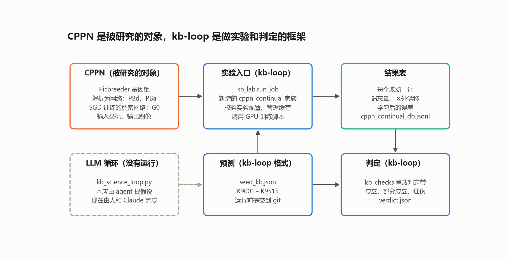

**CPPN 是被研究的对象，kb-loop 是做实验和判定的框架。**

- **CPPN 提供问题。** 它把坐标映射成图像，所以“知识”存在哪里、改动破坏了什么，都能直接看到。同一张图既有进化得到的网络（Picbreeder），也有 SGD 训练的网络，正好用来比较表示。在图像上改一块，就是一个持续学习任务。
- **kb-loop 提供纪律。** 我们在它的代码上新增了 `cppn_continual` 实验家族。实验走 `kb_lab.run_job` 入口，预测写成它的 `seed_kb.json`，运行前提交，结果由 `kb_checks` 按判定线重放，而不是看完结果再解释。
- **还没接上的部分。** kb-loop 的 LLM 循环（`kb_science_loop.py`）没有运行，假说都是人和 Claude 在对话中定的，所以这不是 RSI。接口已经留好：`run_experiment` 工具可以调整回放比例、聚焦比例、标签来源等配置，以后可以交给 agent。

每张图与 kb-loop 的关系不同：

| 图 | 问题 | 怎么来的 |
|---|---|---|
| fig01、fig02、fig04 | 表示差异从哪里来，单次改动 | 第 0 阶段，kb-loop 之外，用 `kb/verify_kb.py` 判定 |
| fig03 | apple 为什么学不动 | 独立的探索脚本，kb-loop 之外 |
| fig05、fig06、fig08、fig09、fig11 | 遗忘和回放 | **走 `kb_lab.run_job`，用 kb-loop 的判定** |
| fig07 | 聚焦回放是否只是记住了标注 | 用 kb-loop 的函数，但直接运行，没有走入口 |
| fig10 | 旋钮长什么样 | 检查规则时的示例，不是判定结果 |

## 一、表示差异从哪里来

### fig01：对称性有相当一部分来自接线

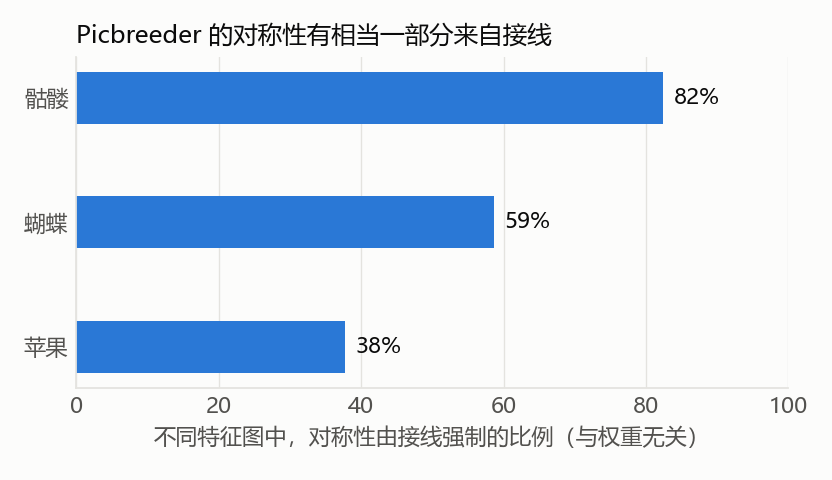

**怎么读：** Picbreeder 的不同特征图里，无论权重取什么都对称的比例。

**和 CPPN 的关系：** CPPN 的坐标输入有奇偶性（x 是奇函数，y、d、b 是偶函数），接线就能强制对称。所以高对称性不能直接读成“学到了更好的表示”。

### fig02：比较表示必须匹配拟合水平

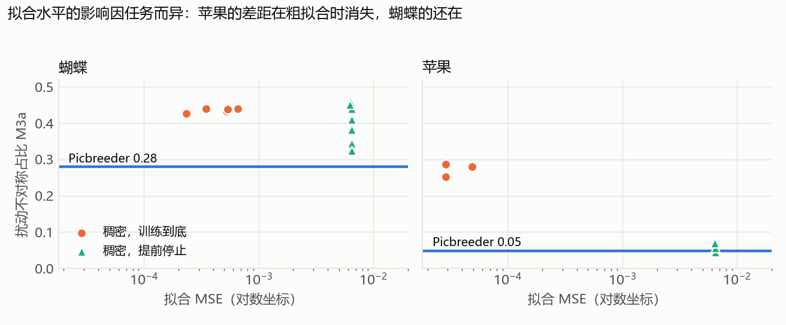

**怎么读：** 横轴是拟合误差，纵轴是扰动不对称的占比，蓝线是 Picbreeder。apple 的稠密网络在粗拟合时就接近蓝线，butterfly 的差距还在。

**和 CPPN 的关系：** 同样的 CPPN 指标，会随拟合水平变化，而且各张图的影响不同。

### fig03：apple 的“学不动”主要是输出层陷阱

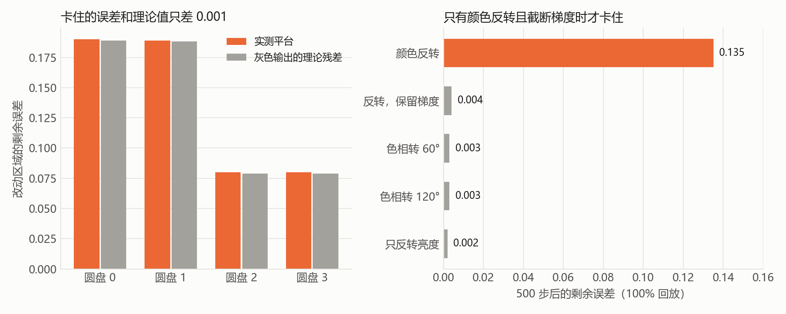

**怎么读：** 左图，卡住的误差和灰色输出的理论残差只差 0.001，这个理论值不用训练就能算出。右图，只有颜色反转且梯度被截断时才卡住。

**和 CPPN 的关系：** 这是 CPPN 的 HSV 输出造成的：反转把饱和度推到 0 以下，截断后梯度消失，图像停在灰色。

**注意：** 保留梯度只在这个设定（单个改动、100% 回放）里算修复。连续改动中它让卡在灰色的比例下降，误差中位数却升高，见 `kbloop_q3/README.md`。

## 二、Picbreeder 有没有优势

### fig04：单次改动时，Picbreeder 区外破坏更大

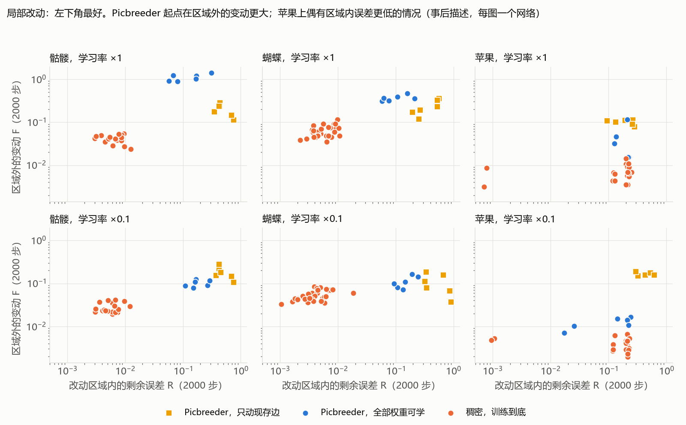

**怎么读：** 左下角最好。橙色是稠密网络，蓝色和黄色是 Picbreeder。skull 和 butterfly 上，稠密网络明显更靠左下。

**注意：** 这是事后描述（C-022），每张图只有一个 Picbreeder 网络。

### fig08：连续改动时，Picbreeder 也没有遗忘得更少

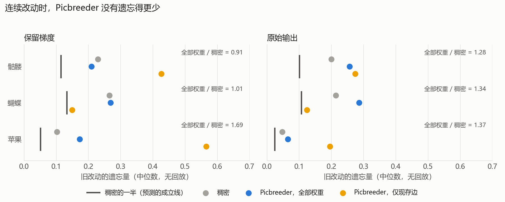

**怎么读：** 每行三个点，粗竖线是预测的成立线（稠密网络的一半）。预测成立的话，蓝点应在竖线左边。

**结论：** 全部权重可学时，比值是 0.91～1.69，预测被证伪。只有 butterfly 上“仅现存边”接近竖线，但它改动后的误差约是稠密网络的 6 倍。

**注意：** apple 在保留梯度下的比较不够干净，结论主要靠 skull、butterfly 和原始输出。

### fig10：旋钮确实存在

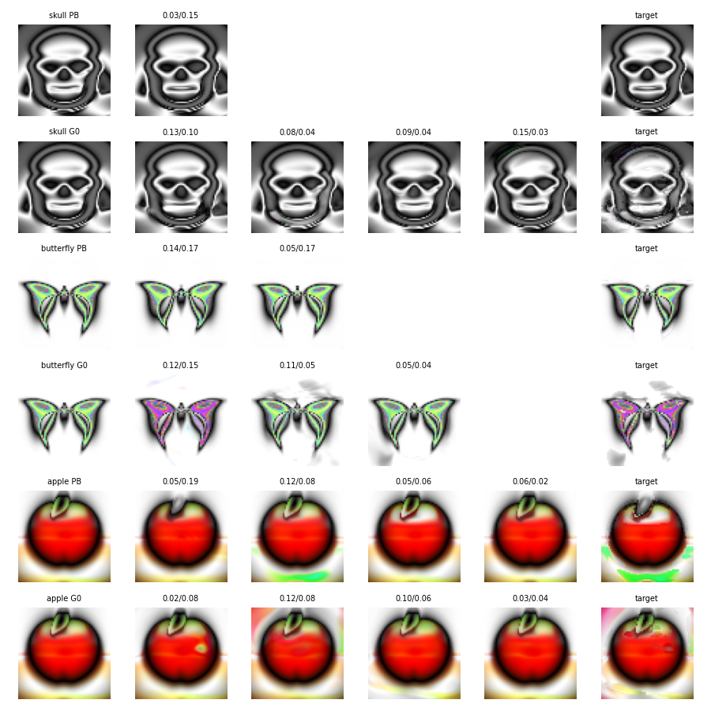

**怎么读：** 每行第一张是原图，中间是改一个权重后的图，最后一张是合成的目标。第 1、3、5 行是 Picbreeder，第 2、4、6 行是稠密网络。Picbreeder 的改动保持对称和结构，稠密网络常出现不对称的斑块。

**注意：** 这是肉眼观察，没有量化。图里用的面积上限是 0.15，正式实验是 0.3，所以 skull 张嘴（面积 0.24）不在这张图里。

### fig11：但梯度学习用不上旋钮

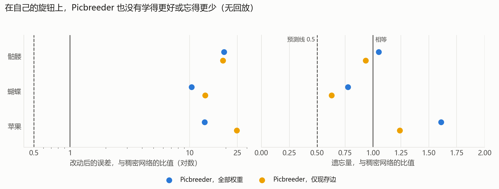

**怎么读：** 点在虚线左边才算预测成立，所有的点都在右边。左图是对数坐标。

**结论：** 目标是 Picbreeder 自己画的，只需移动两个权重就能达到，这个设定偏向它，但它改动后的误差仍是稠密网络的 10～25 倍。

**注意：** 这只否定了梯度这条路，变异或搜索能否用上旋钮没有测。apple 的学习率很小，500 步内到不了移动 1 的解。

## 三、怎样减少遗忘

### fig05：遗忘和回放比例的关系

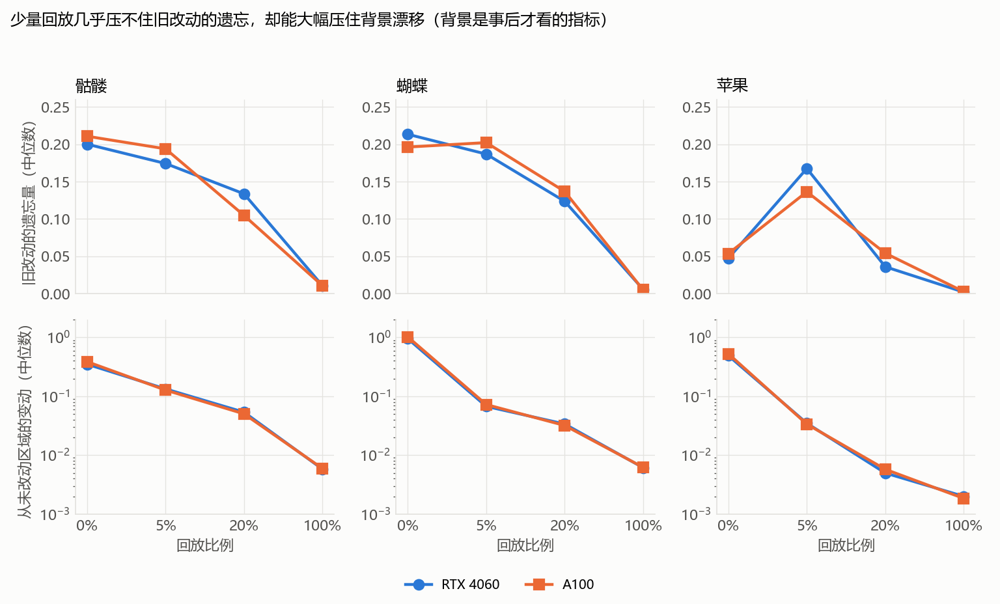

**怎么读：** 上排是旧改动的遗忘量，下排是从未改动区域的漂移，两台机器各一条线。5% 回放几乎压不住遗忘，却大幅压住漂移。

**和 kb-loop 的关系：** 同一条 claim（K9003）在两台机器上判定不同，因为比值落在判定线两侧。所以我们要报比值，不只报判定。

**注意：** 漂移是事后才看的指标。apple 的曲线受输出层陷阱影响。

### fig06：回放放在哪里，比放多少更重要

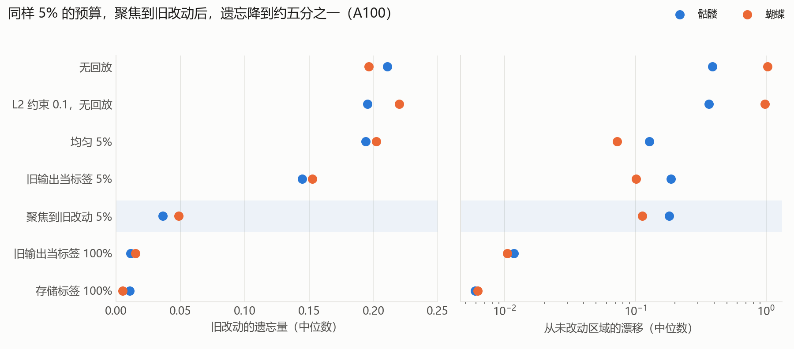

**怎么读：** 越靠左越好。看蓝色带那一行：同样 5% 的预算，遗忘降到均匀回放的 0.19 和 0.24，代价是漂移略高。这是这一阶段**最值得汇报的结果**。

**注意：** 只画了 skull 和 butterfly。这里用的是真实标签，也假定知道旧改动的位置。L2 的强度可能不够，不能说它无效。

### fig07：这不只是记住了被标注的像素

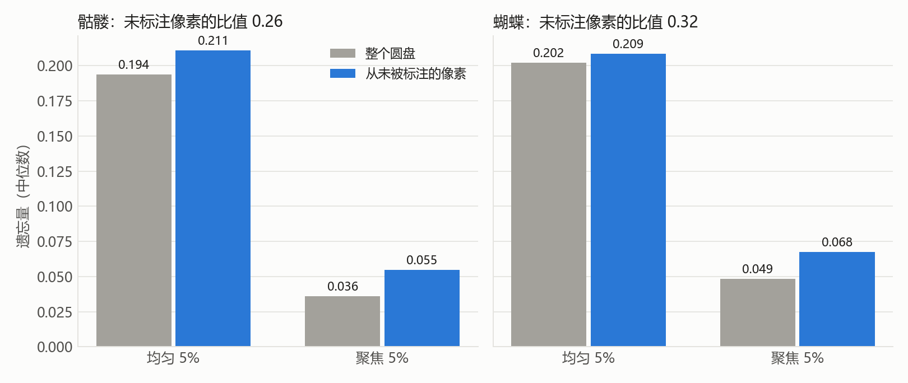

**怎么读：** 聚焦后回放点覆盖了旧圆盘 26%～77% 的像素。蓝柱只算从未被标注的像素，比值是 0.26 和 0.32，仍远低于均匀回放。

**注意：** 这些像素和被标注的像素相邻，所以这只说明保护能扩散到圆盘内部。

### fig09：不存标签也够用

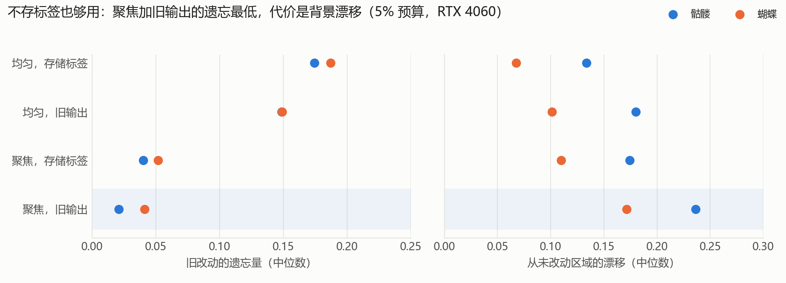

**怎么读：** 最下面一行用网络自己的旧输出当标签，遗忘最低，但右图的漂移也最高。

**注意：** 这不等于什么都不用存：还需要旧改动的位置和一份网络副本。它比存储标签还好的原因没有查。

## 所有图的共同限制

只有 3 张玩具图，每张只有 1 个 Picbreeder 网络，同一网络的多个改动不是独立样本。这些结果都不能外推到其他网络或任务。
